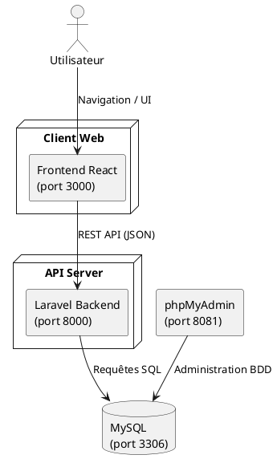
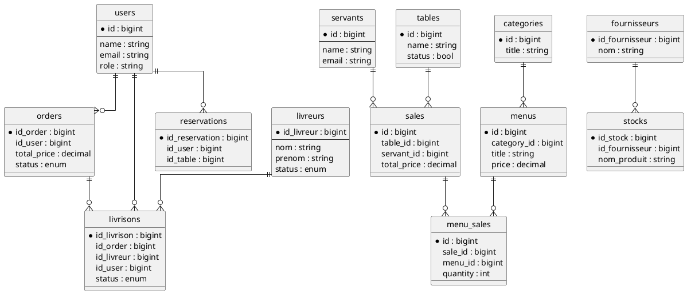
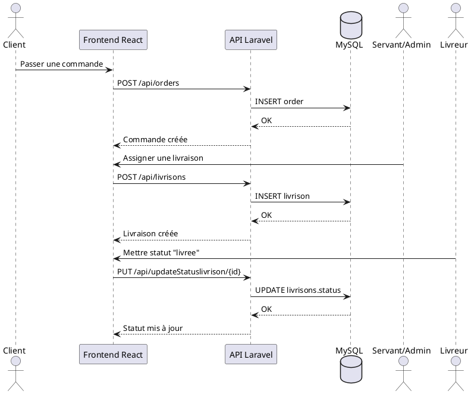

<p align="center"></p>

<h1 align="center">Smart Restaurant Management System (SRMS)</h1>

<p align="center">
Application web full-stack de gestion de restaurant (PFE)<br>
Backend Laravel + Frontend React + MySQL + phpMyAdmin
</p>

---

## 1) Nom de l'application

**Nom officiel:** `Smart Restaurant Management System`  
**Nom court recommandé:** `SRMS`  
**Contexte:** Projet de Fin d'Études (PFE) pour la digitalisation complète des opérations d'un restaurant.

---

## 2) Objectif du projet

SRMS permet de gérer:
- les utilisateurs (admin, client, servant, livreur),
- le menu et les catégories,
- les tables et les réservations,
- les commandes et les livraisons,
- les ventes, stocks, fournisseurs,
- les feedbacks, réclamations et rapports.

---

## 3) Stack technique

### Backend
- Laravel 10.x
- PHP 8.2
- Sanctum (partiellement utilisé pour certains profils)
- Maatwebsite Excel (export des ventes)
- MySQL 8

### Frontend
- React 19
- React Router
- Axios
- TailwindCSS + Bootstrap

### Infrastructure
- Docker / Docker Compose
- MySQL
- phpMyAdmin

---

## 4) Architecture globale

```text
[Navigateur]
    |
    v
[Frontend React :3000]
    |
    v (HTTP / JSON)
[Backend Laravel API :8000]
    |
    v
[MySQL :3306]
    |
    v
[phpMyAdmin :8081]
```

### Diagramme composant (PlantUML)



---

## 5) Rôles, utilisateurs et permissions

> Important: les permissions sont **fortement gérées côté Frontend** (`AuthGuard`, `RoleGuard`) mais **pas strictement verrouillées côté API** (la majorité des routes API sont publiques, sauf `/api/user`).

### 5.1 Rôles existants

- `admin`
- `client`
- `servant`
- `livreur`

### 5.2 Matrice fonctionnelle par rôle

| Rôle | Espace Frontend | Capacités principales |
|---|---|---|
| Admin | `/user/admin/...` | Gestion complète (menu, catégories, tables, servants, livreurs, stocks, fournisseurs, commandes, livraisons, réservations, feedbacks, réclamations, rapports) |
| Client | `/user/client/...` | Inscription/connexion, consultation menu, commandes, réservations, avis, réclamations, profil |
| Servant | `/user/servant/...` | Gestion opérationnelle restaurant: tables, commandes locales/en ligne, livraisons, réservations, menu |
| Livreur | `/user/livreur/...` | Profil, statut actif/inactif, livraisons assignées, historique de livraisons |

### 5.3 Détails techniques d'authentification (état actuel)

- `POST /api/login`
  - `users` (admin/client): authentification session Laravel + token CSRF retourné.
  - `servants` et `livreurs`: création d'un token Sanctum (`createToken`).
- `POST /api/register`: crée un utilisateur avec rôle `client`.
- `POST /api/logout`: logout du guard `web`.

---

## 6) Routes Frontend (React Router)

### 6.1 Routes publiques

- `/`
- `/login`
- `/register`
- `/menu`
- `/feedback`
- `/contact`
- `/about`
- `/local`

### 6.2 Routes Admin

- `/user/admin`
- `/user/admin/dashboard`
- `/user/admin/rapports`
- `/user/admin/ventes`
- `/user/admin/profile`
- `/user/admin/feedbacks`
- `/user/admin/reclamations`
- `/user/admin/fournisseur`
- `/user/admin/stock`
- `/user/admin/stock/details/:id`
- `/user/admin/servants`
- `/user/admin/servants/details/:id`
- `/user/admin/servants/:id/certificate/:type`
- `/user/admin/tables`
- `/user/admin/categories`
- `/user/admin/menus`
- `/user/admin/reservations`
- `/user/admin/orders`
- `/user/admin/livrisons`
- `/user/admin/livreurs`
- `/user/admin/fournisseurs/details/:id`

### 6.3 Routes Client

- `/user/client`
- `/user/client/reclamation`
- `/user/client/avis`
- `/user/client/reservation`
- `/user/client/commande`
- `/user/client/commandes`
- `/user/client/profile`

### 6.4 Routes Servant

- `/user/servant`
- `/user/servant/profil`
- `/user/servant/tables`
- `/user/servant/menu`
- `/user/servant/commandes-locales`
- `/user/servant/commandes-en-ligne`
- `/user/servant/livraisons`
- `/user/servant/reservations`

### 6.5 Routes Livreur

- `/user/livreur`
- `/user/livreur/profile`
- `/user/livreur/status`
- `/user/livreur/livrisons`
- `/user/livreur/historique`
- `/user/livreur/menu`

---

## 7) Routes API complètes

Base URL: `http://localhost:8000/api`

### 7.1 Routes ressources (générées par `apiResource`)

Pour chaque ressource ci-dessous:
- `GET /{resource}`
- `POST /{resource}`
- `GET /{resource}/{id}`
- `PUT/PATCH /{resource}/{id}`
- `DELETE /{resource}/{id}`

Ressources:
- `categories`
- `menus`
- `sales`
- `servants`
- `tables`
- `payments`
- `orders`
- `livreurs`
- `livrisons`

### 7.2 Routes spécifiques

#### Auth
- `POST /login`
- `POST /register`
- `POST /logout`
- `GET /user` (auth:sanctum)

#### Menus
- `GET /menu`
- `GET /menu/category`

#### Tables
- `PUT /tables/{id}/status`

#### Rapports
- `POST /report`
- `POST /export-sales`

#### Feedbacks
- `GET /feedback`
- `POST /feedback`
- `DELETE /feedback/destroy/{id}`

#### Réclamations
- `GET /reclamations`
- `GET /reclamation/user/{id}`
- `POST /reclamations`
- `PUT /reclamations/{id}`
- `DELETE /reclamations/{id}`
- `POST /send-reclamation-response` *(route déclarée)*

#### Fournisseurs / Stocks
- `GET /fournisseurs`
- `POST /fournisseurs`
- `GET /fournisseurs/{id}`
- `PUT /fournisseurs/{id}`
- `DELETE /fournisseurs/{id}`
- `GET /stocks`
- `POST /stocks`
- `GET /stocks/{id}`
- `PUT /stocks/{id}`
- `DELETE /stocks/{id}`

#### Utilisateurs
- `GET /total-workers`
- `PUT /users/{id}`
- `GET /user/client/{id}`
- `PUT /user/client/{id}`
- `GET /admincontact`

#### Réservations
- `GET /reservations`
- `POST /reservations`
- `GET /reservations/{id}`
- `PUT /reservations/{id}`
- `DELETE /reservations/{id}`
- `PUT /reservation/statusv/{id}`
- `PUT /reservation/statusa/{id}`
- `GET /reservation/etattable`
- `PUT /reservation/updateetattable/{id}`
- `GET /nombrestatic`

#### Commandes / Livraison
- `GET /orders/user/{id}`
- `GET /Orders/livreuractif`
- `PUT /orderstatus/{id}`
- `GET /getLivreurActif`
- `PUT /updateStatus/{id}`
- `PUT /updateProfile/{id}`
- `GET /getstatus/{id}`
- `GET /getlivrisonlivreur/{id}`
- `PUT /updateStatuslivrison/{id}`
- `GET /getlivrisonbylivreur/{id}`

---

## 8) JSON de test (Postman / cURL)

> Variable recommandée: `{{base_url}} = http://localhost:8000/api`

### 8.1 Inscription client

```json
POST {{base_url}}/register
Content-Type: application/json

{
  "name": "Client Demo",
  "email": "client.demo@example.com",
  "password": "Password123!",
  "password_confirmation": "Password123!"
}
```

### 8.2 Connexion

```json
POST {{base_url}}/login
Content-Type: application/json

{
  "email": "client.demo@example.com",
  "password": "Password123!"
}
```

### 8.3 Créer une catégorie (Admin)

```json
POST {{base_url}}/categories
Content-Type: application/json

{
  "title": "Boissons",
  "slug": "boissons"
}
```

### 8.4 Créer un menu (Admin, multipart)

```bash
curl -X POST "{{base_url}}/menus" \
  -F "title=Jus d'orange" \
  -F "slug=jus-orange" \
  -F "description=Jus frais" \
  -F "price=25.00" \
  -F "category_id=1" \
  -F "image=@/chemin/vers/image.jpg"
```

### 8.5 Créer une table (Admin)

```json
POST {{base_url}}/tables
Content-Type: application/json

{
  "name": "Table 01",
  "slug": "table-01",
  "status": true
}
```

### 8.6 Créer une réservation (Client)

```json
POST {{base_url}}/reservations
Content-Type: application/json

{
  "id_user": 1,
  "id_table": 1,
  "date": "2026-03-30 20:00",
  "menu": "Pizza 4 fromages",
  "payment": "cash"
}
```

### 8.7 Créer une commande (Client)

```json
POST {{base_url}}/orders
Content-Type: application/json

{
  "total_price": 120.50,
  "status": "en attente",
  "payment_method": "carte",
  "id_user": 1,
  "menu": "[{\"id\":1,\"qty\":2}]"
}
```

### 8.8 Créer une livraison (Admin/Servant)

```json
POST {{base_url}}/livrisons
Content-Type: application/json

{
  "id_livreur": 1,
  "id_order": 1,
  "id_user": 1,
  "date_livrison": "2026-03-31",
  "status": "en_cours",
  "address": "Rue Hassan II, Casablanca"
}
```

### 8.9 Mettre à jour statut livreur

```json
PUT {{base_url}}/updateStatus/1
Content-Type: application/json

{
  "status": "actif"
}
```

### 8.10 Feedback client

```json
POST {{base_url}}/feedback
Content-Type: application/json

{
  "rating": 5,
  "comment": "Excellent service, très bon restaurant."
}
```

### 8.11 Réclamation client

```json
POST {{base_url}}/reclamations
Content-Type: application/json

{
  "message": "La commande est arrivée en retard.",
  "id_user": 1
}
```

### 8.12 Rapport des ventes

```json
POST {{base_url}}/report
Content-Type: application/json

{
  "from": "2026-03-01",
  "to": "2026-03-31"
}
```

---

## 9) Base de données (résumé)

### Tables principales

- `users` (clients/admins)
- `servants`
- `livreurs`
- `categories`
- `menus`
- `tables`
- `sales`
- `menu_sales` (pivot vente <-> menus)
- `orders`
- `livrisons`
- `reservations`
- `feedbacks`
- `reclamations`
- `fournisseurs`
- `stocks`

### Relations clés

- `users` 1..* `orders`
- `users` 1..* `reservations`
- `users` 1..* `reclamations`
- `orders` 1..* `livrisons`
- `livreurs` 1..* `livrisons`
- `categories` 1..* `menus`
- `sales` *..* `menus` via `menu_sales`
- `fournisseurs` 1..* `stocks`

### Diagramme UML (données / relations)



---

## 10) Séquence métier (commande + livraison)



---

## 11) Installation et lancement

## 11.1 Démarrage recommandé (Docker)

```bash
docker compose up -d --build
docker compose exec backend php artisan migrate --force
```

### Accès
- Frontend: `http://localhost:3000`
- Backend API: `http://localhost:8000`
- phpMyAdmin: `http://localhost:8081`
- MySQL: `localhost:3306`

### Paramètres MySQL (Docker Compose)
- Host interne Docker: `mysql`
- Base: `restaurant_db`
- User: `restaurant_user`
- Password: `restaurant_pass`
- Root password: `root`

## 11.2 Lancement manuel (sans Docker)

### Backend
```bash
cd Back-end
composer install
cp .env.example .env
php artisan key:generate
php artisan migrate
php artisan serve
```

### Frontend
```bash
cd front-end
npm install
npm start
```

---

## 12) Vérifications rapides

```bash
# Vérifier les services Docker
docker compose ps

# Voir les routes API Laravel
docker compose exec backend php artisan route:list --path=api --json --no-ansi

# Tester la connexion API
curl http://localhost:8000/api/menu
```

---

## 13) Points techniques importants (état actuel du code)

- La majorité des routes API utilisent seulement le middleware `api` (pas de RBAC serveur strict par rôle).
- La route `POST /api/send-reclamation-response` existe dans `routes/api.php`, mais la méthode `sendResponse` n'existe pas dans `ReclamationController` (à implémenter).
- `apiResource('payments', ...)` expose `show/update/destroy`, mais `PaymentController` implémente actuellement surtout `index` et `store`.
- L'authentification est mixte (session/CSRF pour `users`, token Sanctum pour `servants` et `livreurs`).

---

## 14) Proposition d'amélioration (roadmap)

1. Ajouter un middleware RBAC backend (`admin`, `client`, `servant`, `livreur`) pour sécuriser les routes API.
2. Uniformiser l'authentification via Sanctum pour tous les profils.
3. Corriger les routes déclarées sans implémentation (`send-reclamation-response`, méthodes manquantes `PaymentController`).
4. Publier une collection Postman officielle avec environment (`base_url`, `token`).
5. Ajouter tests automatiques API (Feature tests Laravel).

---

## 15) Licence et auteur

Projet académique PFE, destiné à l'apprentissage et à la démonstration.

Développé par **Said Ouchrif**.
